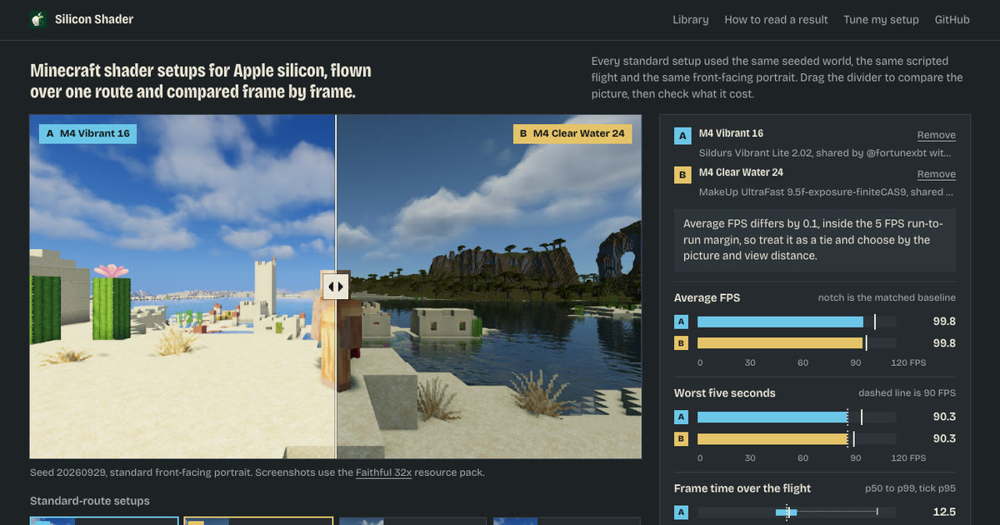

# Silicon Shader

Minecraft Java shader setups for Apple silicon Macs, each with an in-game screenshot and results measured on one shared scripted flight. A CLI and agent skill try a setup in an isolated copy of your game and roll it back if you don't like it.

[](https://fortunexbt.github.io/minecraft-apple-silicon-framework/)

## Try it

Browse and compare setups at [fortunexbt.github.io/minecraft-apple-silicon-framework](https://fortunexbt.github.io/minecraft-apple-silicon-framework/). Every standard-route setup posed for the same frame, so you can drag a divider between two of them and read their FPS and frame times side by side.

To try one on your Mac, give [the starter prompt](agents/START.md) to a coding agent with shell access, such as Codex or Claude Code. It reads your launcher and mods, then tests a compatible recipe in a copy so your worlds and settings stay as they are.

Or use the CLI yourself. It needs Python 3.10+ and has no runtime dependencies. Clone outside Desktop and Documents, because iCloud sync corrupts `.git`.

```sh
git clone https://github.com/fortunexbt/minecraft-apple-silicon-framework.git
cd minecraft-apple-silicon-framework
python3 -m venv .venv && . .venv/bin/activate
python -m pip install .
silicon-shader discover
silicon-shader challenge find --this-mac
```

[docs/WORKFLOW.md](docs/WORKFLOW.md) covers trying a setup and rolling it back. Prism has the most direct support, and other launchers work through an explicit game directory.

## Run the site locally

The site is static and reads an index generated from accepted submissions.

```sh
python3 -m silicon_shader.registry contributions site/data.json
python3 -m http.server 8000 --directory site
```

## What the numbers mean

Results come from a base M4 MacBook Pro (10 CPU and 10 GPU cores, 24 GiB) flying [the shared seeded route](docs/WORKLOAD.md). Each setup is one matched pair, a baseline and a candidate flown back to back on that route. The metric is CPU frame production, which can differ from the FPS your display shows. Run-to-run noise is about 1 to 3 FPS, so gaps under 5 FPS are ties. Entries are self-reported and unaudited, and no other Mac has current results yet. The [hardware list](docs/HARDWARE.md) names every Apple silicon Mac, which doesn't mean each was tested.

Each accepted run lives as a JSON bundle in [contributions/](contributions/), and [docs/FAIRNESS.md](docs/FAIRNESS.md) explains how to compare them. The older campaign is in [docs/EXPERIMENTS.md](docs/EXPERIMENTS.md) and `evidence/`. The M4 Wide View recipe was measured on an earlier route and isn't comparable with the rest.

The CLI only writes to an isolated managed copy. It never launches Minecraft, installs arbitrary mods or uploads anything while tuning. Automatic measurement needs an agent that can drive the game (chat commands, F2, window focus) with macOS Accessibility permission. Without that you still get the setup, reported as unmeasured. It doesn't cover Bedrock, Intel Macs, iPhone, iPad or Windows.

## Contributing

Read [AGENTS.md](AGENTS.md) first and run `python3 -m unittest discover -s tests -v`. Sampler changes also run `./sampler/smoke.sh`. To share a measured setup, see [docs/CHALLENGE.md](docs/CHALLENGE.md). Data-only submissions that validate merge automatically, and recipe or tool changes get reviewed.

## Licence

Original code is [MIT](LICENSE). Mods, shaders, the Faithful 32x textures in the screenshots and the site font are credited in [THIRD_PARTY.md](THIRD_PARTY.md). This is an independent project, not affiliated with Apple or Prism.

**NOT AN OFFICIAL MINECRAFT PRODUCT. NOT APPROVED BY OR ASSOCIATED WITH MOJANG OR MICROSOFT.**
